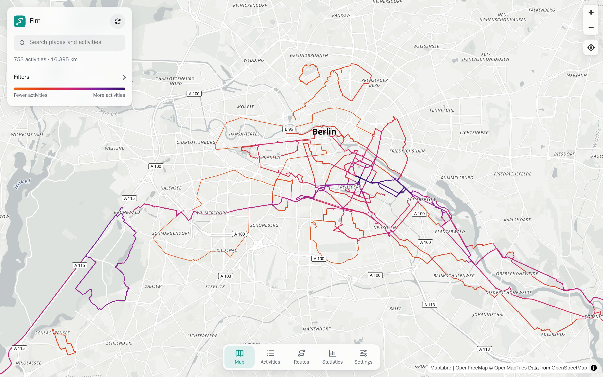
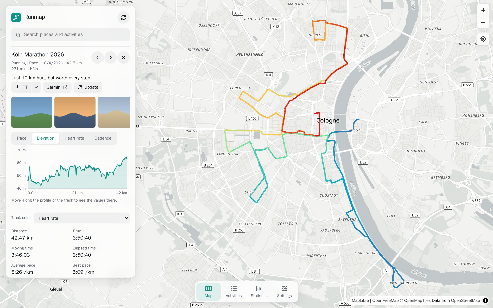
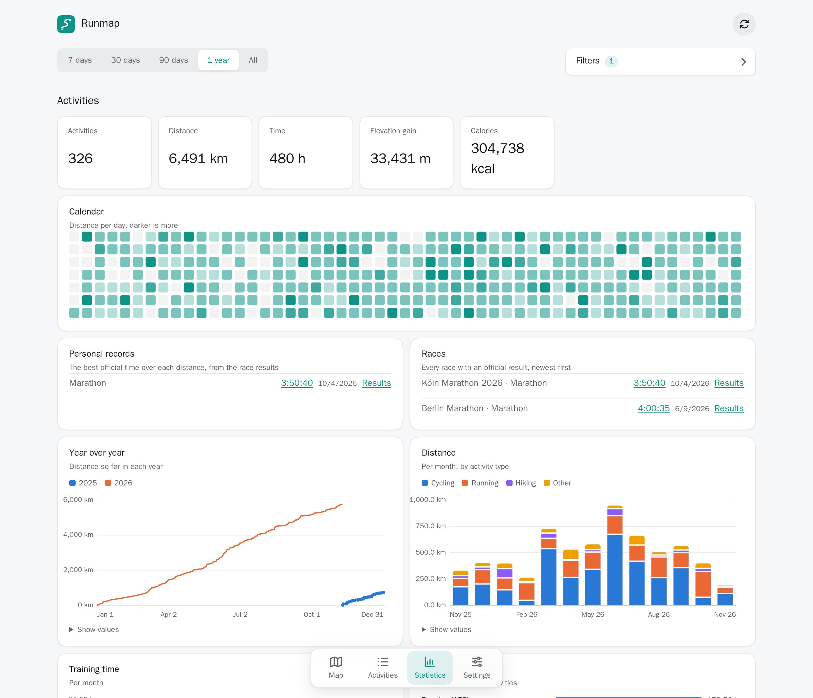
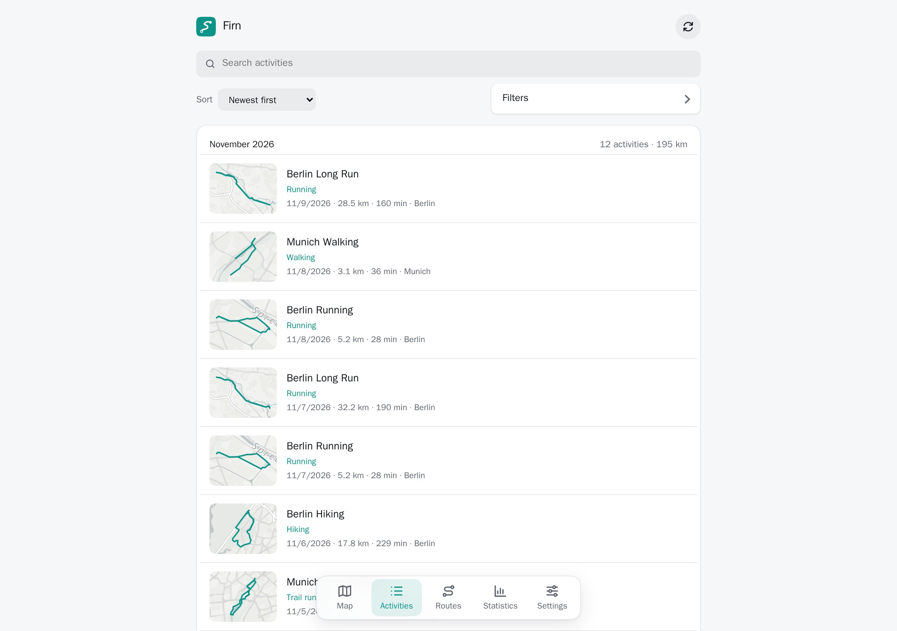
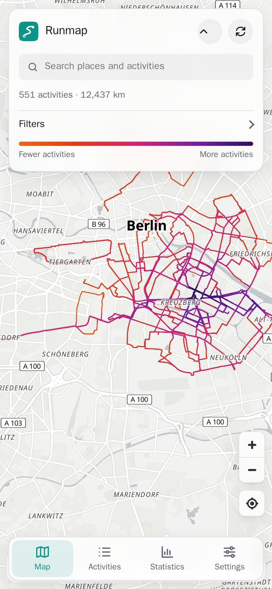

# Firn

A heatmap of all your Garmin activities on a global map, with statistics on
your training, sleep and health. Self-hosted, for you and the people you share
a server with.

<picture>
  <source media="(prefers-color-scheme: dark)" srcset="docs/screenshots/map-dark.jpg">
  
</picture>

All screenshots show made-up data from the demo, see [Development](#development).

## Features

- **Heatmap** of every activity with GPS. Streets you take often glow brighter.
  Search for places and activities, and filter by type, title, description,
  location, distance, duration and date. Filters and the selected activity stay
  in the link, so you can bookmark and share a view.
- **Activity details** with a profile of pace, elevation, heart rate, cadence
  and power to scrub along, the track colored by any of them, kilometer or mile
  splits, heart rate zones, photos, the weather, the primary training effect
  and the watch and sensors that recorded it, which the activity list shows too. Download the original
  FIT file or a GPX file, and step to the previous or next activity.
- **Routes** to run again: save the track of an activity as a route, or import
  a GPX file. Routes show on a map with distance and climb, can be renamed and
  downloaded as GPX.
- **Statistics** on distance, time, pace, heart rate, VO2 max and training load,
  a calendar of the last year and a year over year comparison.
- **Personal records** from the official race results you enter for an
  activity, each linked to the published results, with the time you aimed for.
  Races can be filtered by training block, which runs from the last race at
  least as long to the race itself. Race days wear a crown in the calendar. Health charts cover sleep, HRV, resting heart rate, stress, Body
  Battery, steps, SpO2, weight and more.
- **Everything from Garmin**, synced with the Personal API: activities with and
  without GPS, their files, details and photos, and all health data. Syncs can
  run on a schedule, continue where they stopped and be cancelled.
- **Your data stays yours**: export everything as one ZIP and import it into
  another Firn. Import FIT, GPX and TCX files from other apps and devices too.
- **Accounts** through OpenID Connect. Each person adds their own Garmin key and
  sees only their own data.
- English and German, metric and imperial units, light and dark themes, phone
  layouts, keyboard shortcuts, and an installable app that opens offline.

<table>
  <tr>
    <td>
      <picture>
        <source media="(prefers-color-scheme: dark)" srcset="docs/screenshots/activity-dark.jpg">
        
      </picture>
    </td>
    <td>
      <picture>
        <source media="(prefers-color-scheme: dark)" srcset="docs/screenshots/statistics-dark.jpg">
        
      </picture>
    </td>
  </tr>
  <tr>
    <td>
      <picture>
        <source media="(prefers-color-scheme: dark)" srcset="docs/screenshots/activities-dark.jpg">
        
      </picture>
    </td>
    <td align="center">
      
    </td>
  </tr>
</table>

## Before you run it

**Keep it off the public internet.** I recommend running Firn behind a VPN, for
example [WireGuard](https://www.wireguard.com), and not exposing it to the
internet. It holds your health and training data, and the map shows where you
live and where you go.

**It is vibe coded.** I write this project with the help of AI, and I review
that code less thoroughly than I review production software. I do value data
integrity and want to keep it: I use Firn myself and rely on it to back up my
health and training data. Still, keep your own backups of the database and the
`data` volume, and of your Garmin data, which stays on Garmin Connect.

## Getting started

Runs on a server with Docker, behind a reverse proxy that serves HTTPS. Needs an
OpenID Connect provider, like Authentik, Keycloak, Authelia or Google.

1. Get the images. The **Images** workflow in `.github/workflows/images.yaml`
   checks the code, then builds `ghcr.io/konstantintutsch/firn/backend` and
   `ghcr.io/konstantintutsch/firn/frontend` on GitHub Actions and pushes them to
   the GitHub container registry.
2. Create an OpenID Connect client at your provider, with the redirect URI
   `https://firn.example.com/api/auth/callback`, for the address you serve Firn at.
3. Copy `examples/docker-compose.yaml` and `examples/.env.example` to the server
   as `docker-compose.yaml` and `.env`. Fill in `.env`: `FIRN_IMAGES`,
   `POSTGRES_PASSWORD`, `APP_SECRET`, `PUBLIC_URL` and the `OIDC_` variables.
4. Run `docker compose up -d`. Point the reverse proxy at `127.0.0.1:8080`.
   Sign-in cookies are only marked secure if `PUBLIC_URL` starts with
   `https://`.
5. Open `PUBLIC_URL` and sign in.
6. Create a Personal API key on
   [Garmin Connect](https://connect.garmin.com/app/settings/personalApiToken)
   and add it under **Settings**.
7. Select **Sync** to save your data. Select it again at any time to add new data,
   or set `SYNC_INTERVAL_HOURS`.

The API documentation is at `/api/docs`.

### Upgrading

Pull the new images and run `docker compose up -d`. The backend migrates the
database when it starts. Back up the database and the `data` volume first:
there is no way back to an older version after a migration.

Versions before the file store kept original files and photos in the database.
The first start of a newer version moves them to `DATA_DIR`, which can take a
while for a long history. An interrupted move continues on the next start.

### Upgrading from a version without accounts

The first account to sign in takes over all saved activities. Add the Garmin key
again under **Settings**; `GARMIN_PERSONAL_API_KEY` is no longer read.

## Configuration

Set these in `.env`.

| Variable | Default | What it does |
|---|---|---|
| `APP_SECRET` | | Encrypts the Garmin keys. At least 32 characters, for example from `openssl rand -base64 32`. Changing it makes saved keys unreadable. |
| `PUBLIC_URL` | `http://localhost:8080` | The address people open Firn at. |
| `OIDC_ISSUER`, `OIDC_CLIENT_ID`, `OIDC_CLIENT_SECRET` | | The OpenID Connect client. Leave the secret empty for a public client. |
| `OIDC_CA_CERT` | | A PEM file with certificates to trust for the provider, like a local test CA. |
| `SYNC_INTERVAL_HOURS` | `0` | Syncs every account with a key every this many hours. `0` turns it off. |
| `DATA_DIR` | `/data` | Where original files and photos are kept, a volume in the compose files. |
| `HEALTH_HISTORY_DAYS` | `365` | How far back health data goes at least, also for accounts with few activities. |
| `DOWNLOAD_PAUSE_MS` | `500` | Pause between Garmin requests, to stay gentle on Garmin's servers. |
| `API_DOCS` | `true` | Serves the API documentation at `/api/docs`. |
| `LOG_JSON` | `false` | Logs JSON lines instead of text. |
| `RUST_LOG` | `info` | How much the backend logs, like `debug` for every request. |
| `WEB_BIND`, `WEB_PORT` | `127.0.0.1`, `8080` | Where `just up` serves the app. |
| `POSTGRES_PASSWORD` | `firn` | The database password. |

## What a sync saves

Firn copies everything the Garmin Personal API offers:

- Every activity, with or without GPS: the summary, the details, the original
  file, its workouts and its photos. Only activities with GPS go on the map.
- Health data from the first activity on, and at least one year back: daily
  summaries, sleep, HRV, heart rate, stress, Body Battery, steps, intensity
  minutes, floors, SpO2, respiration, weight and body composition,
  fitness age, food logs, menstrual cycle, profile settings and heart rate zones.

Each Garmin response is stored as it came, in `garmin_documents`. The statistics
page reads daily values from them. Garmin does not document these responses, so
a value that Garmin moved may be missing from the charts, but never from the
saved data.

The first sync makes one request per day for some kinds of data, which takes a
while for a long history. A sync can be interrupted or stopped: the next one
continues where it stopped, and always fetches the last few days again, since
Garmin keeps updating them. Server errors and short rate limits are retried.

## Import and export

**Settings → Export** downloads one ZIP with every activity, its file, details
and photos, all routes and all health data. **Import** restores such an export, here or
in another Firn.

Import also takes a ZIP of FIT, GPX or TCX files, also inside ZIPs of their own
like Garmin's downloads. Firn reads the date, distance, time, elevation and
heart rate from each file. Such activities get a negative ID, since Garmin does
not know them, and importing the same file again updates it instead of adding
it twice. Files from elsewhere do not say their time zone, so their times are in
UTC.

**Import** opens a dialog before the file dialog. Choose *An Apple Health export*
to import the ZIP that the Health app makes: the daily values (steps, distance,
calories, floors, heart rate, HRV, breathing, blood oxygen, sleep and
weight), every VO2 max (even several on a day, each linked to its workout if
that was imported) and, if you choose so, its workouts as activities with their
routes.
Where Garmin saved a value for a day already, it stays.

Check **Keep only the data from the import** before choosing a file to set the
account to the state of the import: activities, routes and health data that are
not in it are removed. This cannot be undone, and nothing is removed if some
files of the import could not be read. A later sync from Garmin saves the removed
activities again. Over the API, pass `replace=true` to `POST /api/import`, and `apple_health=health` or
`apple_health=workouts` for an Apple Health export.

## Garmin access

Firn uses the [Garmin Connect Personal API](https://developer.garmin.com/gc-developer-program/personal/personal-api),
which is meant for personal use. Keys expire after the period you chose when
creating them. The app tells you when a key stops working: create a new one and
add it under **Settings**.

## Data and privacy

- A Garmin key gives access to your Garmin data. Firn stores it encrypted with
  `APP_SECRET`, and never returns it. Keep `.env` private: without `APP_SECRET`,
  a copy of the database does not reveal the keys. Changing `APP_SECRET` makes
  saved keys unreadable, so everyone has to add theirs again.
- Original files and photos are in `DATA_DIR`, everything else in Postgres.
- Sessions last 30 days. The database stores only a hash of each session token.
- The map shows where you go, including near your home. All data requires a
  session, and each account sees only its own data.
- **Settings → Delete account** deletes all of an account's data in Firn. The
  data on Garmin Connect stays.
- Map tiles come from [OpenFreeMap](https://openfreemap.org), which sees the
  areas you view.
- Place search uses [Photon](https://photon.komoot.io), which sees what you type
  in the search box, including when you search for an activity.

## Development

Requires Docker, [just](https://just.systems) and an OpenID Connect provider.
`just` lists all commands.

1. Create an OpenID Connect client at your provider, with the redirect URI
   `http://localhost:8080/api/auth/callback`.
2. Copy `.env.example` to `.env`. Fill in `APP_SECRET`, `OIDC_ISSUER`,
   `OIDC_CLIENT_ID` and `OIDC_CLIENT_SECRET`.
3. Run `just up` and open <http://localhost:8080>. The API documentation is at
   <http://localhost:8080/api/docs>.

To serve it at another address, set `PUBLIC_URL` to it and `WEB_BIND` to
`0.0.0.0`, and register `${PUBLIC_URL}/api/auth/callback` at the provider.

| Command | What it does |
|---|---|
| `just up`, `just down` | Starts and stops the app at <http://localhost:8080>. |
| `just dev` | Starts the app and rebuilds it on file changes. |
| `just test` | Runs the backend tests in a throwaway database. |
| `just lint`, `just fmt` | Checks and formats the code. |
| `just demo`, `just demo-down` | Starts and stops a separate Firn with made-up data at <http://localhost:8090>. |
| `just screenshots` | Takes the screenshots above from the demo. |

The demo has its own database and never touches your data. A small Python
server in `dev/demo/fake_garmin.py` stands in for Garmin and serves two years of
generated activities, tracks, photos and health data, the same on every start.
Open the demo with the cookie `firn_session=demo-session-token`, which
`dev/demo/seed.sh` creates.

### Trying it with a local Authelia

`just authelia` starts the app with a local [Authelia](https://www.authelia.com)
at <https://authelia.localhost:9091>, already set up as the provider. Sign in as
`alice` or `bob`, both with the password `firn`. `.env` still needs
`APP_SECRET`.

The first run creates a test CA and certificate in `dev/authelia/secrets`. The
browser warns about the certificate: accept it, or trust
`dev/authelia/secrets/ca.public.crt`. Chrome and Firefox find
`authelia.localhost` on their own. Other browsers may need
`127.0.0.1 authelia.localhost` in `/etc/hosts`.

Only use this to try Firn out: the configuration's secrets are public.
