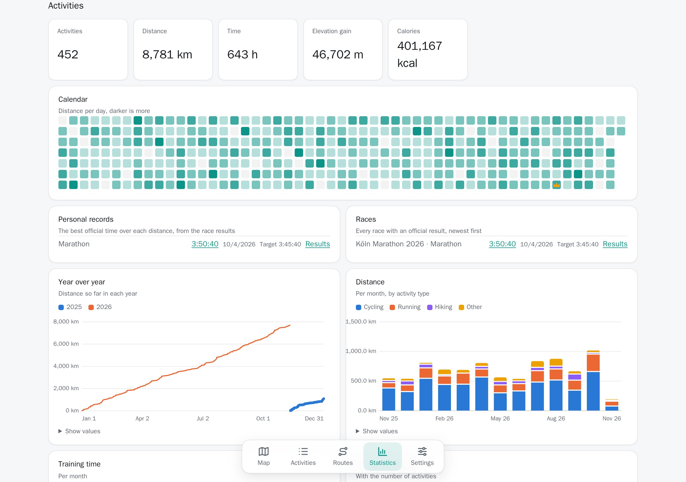
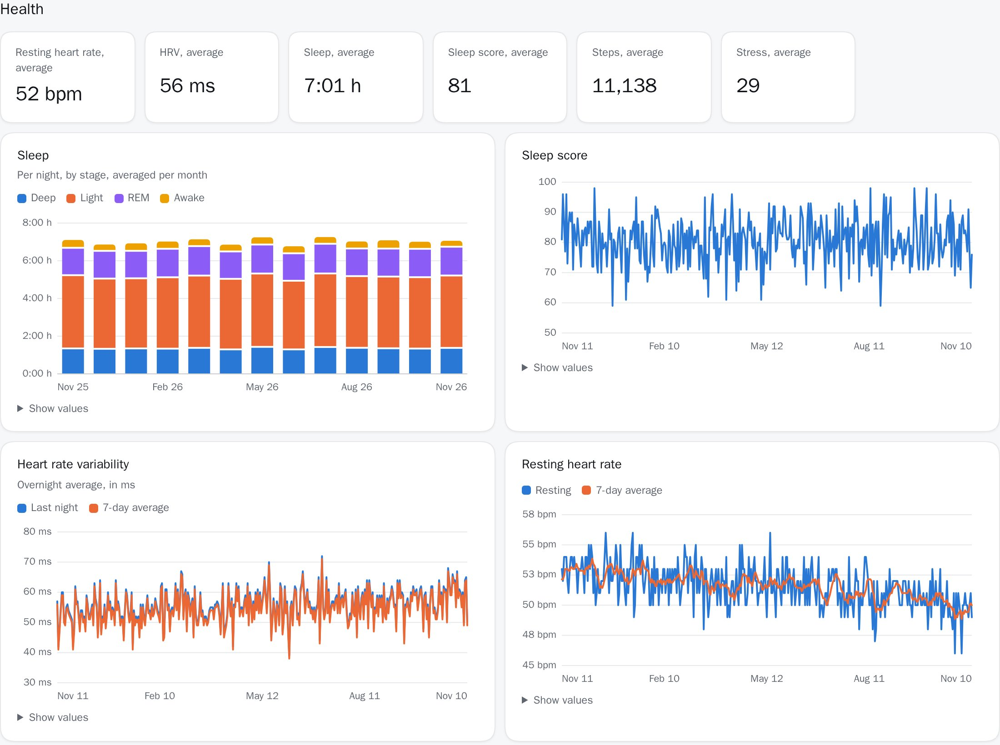

# Firn

A self-hosted heatmap of your endurance training activities, with statistics on your
training, sleep and health.

<picture>
  <source media="(prefers-color-scheme: dark)" srcset="docs/screenshots/map-dark.jpg">
  
</picture>

All screenshots show made-up data from the demo, see [Development](#development).

Are you interested in why I build this project, what motivates me to run it and in what direction I want to take it? This [blog post](https://konstantintutsch.com/blog/introducing-firn/) may answer your questions!

## Features

- **Heatmap** of every activity with GPS, with search and filters. Filters and
  the selected activity stay in the link, so you can share a view.
- **Activity details**: pace, elevation, heart rate, cadence and power profiles,
  splits, heart rate zones, photos, weather and training effect. Download the
  original FIT file or a GPX file.
- **Routes**: save an activity's track as a route, or import a GPX file.
- **Statistics** on training, a calendar, a year over year comparison, personal
  records from your races, and health charts for sleep, HRV, stress, Body
  Battery and more.
- **Everything from Garmin**, synced with the Personal API on a schedule or on
  demand.
- **Your data stays yours**: export everything as one ZIP, and import FIT, GPX,
  TCX or Apple Health files.
- **Accounts** through OpenID Connect. Each person sees only their own data.
- English and German, metric and imperial units, light and dark themes, phone
  layouts and an installable app that opens offline.

## Screenshots

### Activity

<picture>
  <source media="(prefers-color-scheme: dark)" srcset="docs/screenshots/activity-dark.jpg">
  
</picture>

### Training statistics

<picture>
  <source media="(prefers-color-scheme: dark)" srcset="docs/screenshots/training-dark.jpg">
  
</picture>

### Health statistics

<picture>
  <source media="(prefers-color-scheme: dark)" srcset="docs/screenshots/health-dark.jpg">
  
</picture>

### Activities

<picture>
  <source media="(prefers-color-scheme: dark)" srcset="docs/screenshots/activities-dark.jpg">
  
</picture>

### Phone

## Notes

- **Keep it off the public internet.** Use a VPN like
  [WireGuard](https://www.wireguard.com). Firn holds your health data, and the
  map shows where you live.
- **Most of the code was written with AI.** I did not review the base before
  building on it, and I am now improving its quality. Keep backups of the
  database and the `data` volume.

## Getting started

Needs a server with Docker, a reverse proxy that serves HTTPS, and an OpenID
Connect provider like Authentik, Keycloak, Authelia or Google.

1. Create an OpenID Connect client at your provider, with the redirect URI
   `https://firn.example.com/api/auth/callback`, for the address you serve Firn at.
2. Copy `examples/docker-compose.yaml` and `examples/.env.example` to the server
   as `docker-compose.yaml` and `.env`. Fill in `.env`: `FIRN_IMAGES`,
   `POSTGRES_PASSWORD`, `APP_SECRET`, `PUBLIC_URL` and the `OIDC_` variables.
3. Run `docker compose up -d`. Point the reverse proxy at `127.0.0.1:8080`.
   Cookies are only marked secure if `PUBLIC_URL` starts with `https://`.
   The proxy must send the `X-Forwarded-For` header, which Caddy and Traefik
   do on their own. Without it, all clients share one limit on sign-ins.
4. Open `PUBLIC_URL` and sign in.
5. Create a Personal API key on
   [Garmin Connect](https://connect.garmin.com/app/settings/personalApiToken)
   and add it under **Settings**.
6. Select **Sync**. Select it again at any time to add new data, or set
   `SYNC_INTERVAL_HOURS`.

The API documentation is at `/api/docs`. The example turns it off. Set
`API_DOCS=true` in `.env` to serve it.

### Upgrading

Back up the database and the `data` volume, pull the new images and run
`docker compose up -d`. The backend migrates the database on start. There is no
way back to an older version after a migration.

## Configuration

Set these in `.env`.

| Variable | Default | What it does |
|---|---|---|
| `APP_SECRET` | | Encrypts the Garmin keys. At least 32 characters, for example from `openssl rand -base64 32`. Changing it makes saved keys unreadable. |
| `PUBLIC_URL` | `http://localhost:8080` | The address people open Firn at. |
| `OIDC_ISSUER`, `OIDC_CLIENT_ID`, `OIDC_CLIENT_SECRET` | | The OpenID Connect client. Leave the secret empty for a public client. |
| `OIDC_CA_CERT` | | A PEM file with certificates to trust for the provider. |
| `SYNC_INTERVAL_HOURS` | `0` | Syncs every account with a key every this many hours. `0` turns it off. |
| `DATA_DIR` | `/data` | Where original files and photos are kept. |
| `HEALTH_HISTORY_DAYS` | `365` | How far back health data goes at least. |
| `DOWNLOAD_PAUSE_MS` | `500` | Pause between Garmin requests. |
| `API_DOCS` | `true` | Serves the API documentation at `/api/docs`. |
| `LOG_JSON` | `false` | Logs JSON lines instead of text. |
| `RUST_LOG` | `info` | How much the backend logs. |
| `WEB_BIND`, `WEB_PORT` | `127.0.0.1`, `8080` | Where `just up` serves the app. |
| `POSTGRES_PASSWORD` | `firn` | The database password. |

## Sync, import and export

A sync saves every activity (with or without GPS) with its details, original
file and photos, and health data from the first activity on, at least one year
back. Each Garmin response is stored as it came, in `garmin_documents`. Syncs
can be interrupted: the next one continues where it stopped and fetches the last
few days again.

**Settings → Export** downloads one ZIP with all your data. **Import** restores
it, here or in another Firn. It also takes FIT, GPX and TCX files, or ZIPs of
them. Such activities get a negative ID, and their times are in UTC.

**Import** also takes an Apple Health export: daily values, VO2 max and,
optionally, workouts as activities. Values Garmin saved for a day stay.

Check **Keep only the data from the import** to remove everything that is not in
the import. This cannot be undone. Over the API, pass `replace=true` to
`POST /api/import`, and `apple_health=health` or `apple_health=workouts` for an
Apple Health export.

## Data and privacy

- Garmin keys are stored encrypted with `APP_SECRET` and never returned. Keep
  `.env` private.
- Original files and photos are in `DATA_DIR`, everything else in Postgres.
- Sessions last 30 days. Only a hash of each session token is stored.
- All data requires a session, and each account sees only its own data.
- **Settings → Delete account** deletes all of an account's data in Firn. Data
  on Garmin Connect stays.
- Map tiles come from [OpenFreeMap](https://openfreemap.org), which sees the
  areas you view.
- Place search uses [Photon](https://photon.komoot.io), which sees what you
  type in the search box.

## Development

Requires Docker, [just](https://just.systems) and an OpenID Connect provider.
`just` lists all commands.

1. Create an OpenID Connect client at your provider, with the redirect URI
   `http://localhost:8080/api/auth/callback`.
2. Copy `.env.example` to `.env`. Fill in `APP_SECRET`, `OIDC_ISSUER`,
   `OIDC_CLIENT_ID` and `OIDC_CLIENT_SECRET`.
3. Run `just up` and open <http://localhost:8080>.

To serve it at another address, set `PUBLIC_URL` to it and `WEB_BIND` to
`0.0.0.0`, and register `${PUBLIC_URL}/api/auth/callback` at the provider.

| Command | What it does |
|---|---|
| `just up`, `just down` | Starts and stops the app. |
| `just dev` | Starts the app and rebuilds it on file changes. |
| `just test` | Runs the backend tests in a throwaway database. |
| `just lint`, `just fmt` | Checks and formats the code. |
| `just demo`, `just demo-down` | Starts and stops a separate Firn with made-up data at <http://localhost:8090>. |
| `just screenshots` | Takes the screenshots above from the demo. |

The demo has its own database. `dev/demo/fake_garmin.py` stands in for Garmin
and serves generated data. Open the demo with the cookie
`firn_session=demo-session-token`, which `dev/demo/seed.sh` creates.

### Trying it with a local Authelia

`just authelia` starts the app with a local [Authelia](https://www.authelia.com)
at <https://authelia.localhost:9091>, already set up as the provider. Sign in as
`alice` or `bob`, both with the password `firn`. `.env` still needs
`APP_SECRET`.

The first run creates a test CA in `dev/authelia/secrets`. Accept the
certificate warning, or trust `dev/authelia/secrets/ca.public.crt`. Some
browsers need `127.0.0.1 authelia.localhost` in `/etc/hosts`.

Only use this to try Firn out: the configuration's secrets are public.
